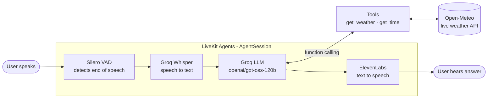
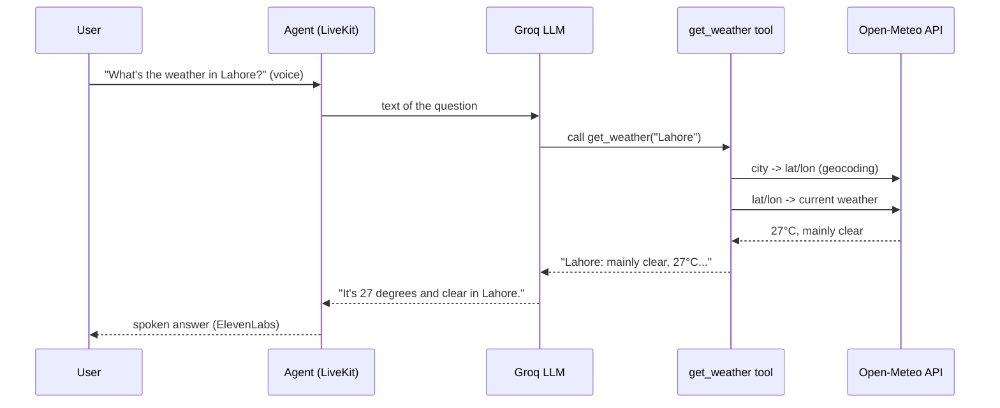

# Architecture

**Department:** Technical — Design

## The pipeline

A voice agent listens, thinks and speaks. LiveKit connects all the parts in real time.

## Each part, in one line

| Part | Tool | Job | Where in code |
| --- | --- | --- | --- |
| Transport + framework | LiveKit Agents | Streams audio in real time, runs the pipeline, handles interruptions | `agent.py` → `AgentSession` |
| VAD | Silero | Detects when the user stopped speaking, so the agent knows when to reply | `vad=silero.VAD.load()` |
| STT | Groq Whisper (`whisper-large-v3-turbo`) | Turns speech into text; detects English or Urdu | `stt=groq.STT(...)` |
| LLM | Groq (`openai/gpt-oss-120b`) | Understands the question, decides the answer, calls tools | `llm=groq.LLM(...)` |
| Tools | Python functions | Fetch live data the LLM cannot know | `tools.py` |
| Weather data | Open-Meteo | Free weather API, no key needed | `tools.py` → `get_weather` |
| TTS | ElevenLabs (`eleven_v3_conversational`) | Speaks the answer in a natural voice; real-time; supports Urdu and 70+ languages | `tts=elevenlabs.TTS(...)` |
| Personality | `prompt.txt` | Name, rules, short answers, always use tools for weather/time | `Assistant(instructions=PROMPT)` |

## How a weather question flows (function calling)

**Why a tool?** The LLM learned from data up to a fixed date. It does not know today's weather and cannot browse the internet by itself. Without a tool it would refuse or guess. The tool gives it real data.

## Two ways to run

| Mode | Command | What happens |
| --- | --- | --- |
| Console | `python agent.py console` | Uses the laptop mic and speakers, in the terminal |
| Dev (browser) | `python agent.py dev` | Laptop connects to LiveKit Cloud; talk from the browser Agent Console |
